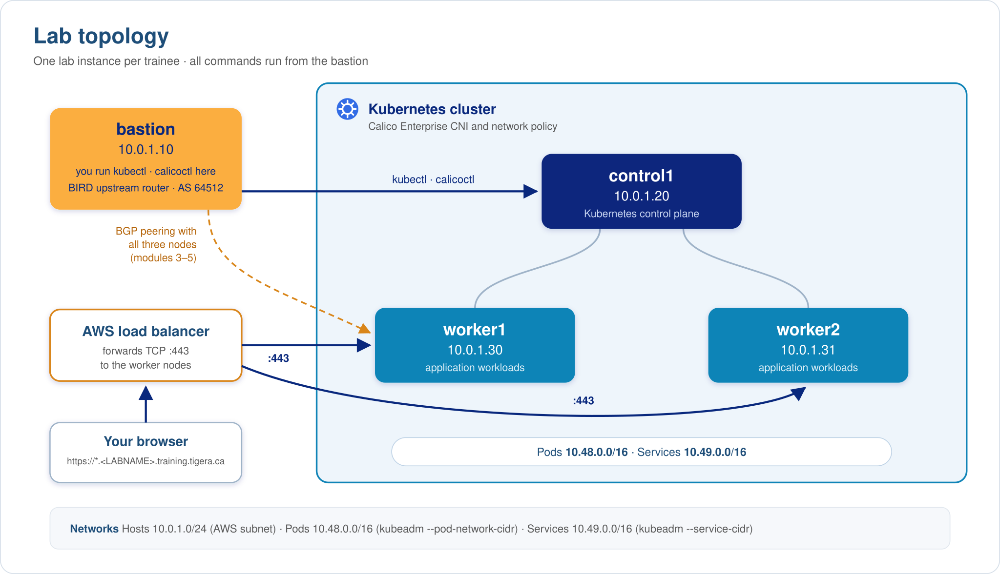

# Calico LoadBalancer, Ingress Gateway and Egress Gateway Workshop

Hands-on lab guide for a 2-hour Calico Enterprise workshop on getting traffic into and out of a Kubernetes cluster:

| Lab | What you do |
|---|---|
| [Lab 1: Calico LoadBalancer](1.Calico-LoadBalancer/README.md) | Assign LoadBalancer Service IPs from a Calico IPPool, advertise them over BGP, preserve the client IP with `externalTrafficPolicy: Local`, and (optional, eBPF) enable Maglev load balancing |
| [Lab 2: Calico Ingress Gateway](2.Calico-Ingress-Gateway/README.md) | Enable Calico Ingress Gateway and build one shared Gateway API Gateway with TLS passthrough and TLS termination |
| [Lab 3: Calico Egress Gateway](3.Calico-Egress-Gateway/README.md) | Give a namespace a fixed, routable source IP when it leaves the cluster |

Do the labs in order: Lab 1 sets up the BGP peering and BGPConfiguration that Lab 3 builds on.

Based on [Kubernetes-Networking-Training](https://github.com/tigera-cs/Kubernetes-Networking-Training) (modules 4, 5 and 6) and the [Calico Ingress Gateway Instructor-Led Workshop](https://github.com/tigera-cs/Calico-Ingress-Gateway-Instructor-Led-Workshop).

---

## Lab topology



| Node | IP address | Role |
|---|---|---|
| `bastion` | `10.0.1.10` | Outside the cluster. Runs `kubectl` and `calicoctl`, and a standalone BIRD instance that acts as the upstream BGP router (AS `64512`). Also used to test connectivity from outside the cluster. |
| `control1` | `10.0.1.20` | Kubernetes control-plane node |
| `worker1` | `10.0.1.30` | Kubernetes worker node |
| `worker2` | `10.0.1.31` | Kubernetes worker node |

| CIDR | Purpose |
|---|---|
| `10.0.1.0/24` | Host network |
| `10.48.0.0/16` | Pod network (kubeadm `--pod-network-cidr`) |
| `10.49.0.0/16` | Service network (kubeadm `--service-cidr`) |
| `10.50.0.0/26` | `loadbalancer-ip-pool`, LoadBalancer Service IPs (Lab 1) |
| `10.10.10.0/30` | `egress-ippool-1`, egress gateway IPs (Lab 3) |

All commands run from the `bastion` unless a step says to SSH into a node. To reach a cluster node from the bastion:

```bash
ssh control1
ssh worker1
ssh worker2
```

---

## Before the workshop

* **Calico Enterprise version.** The labs need Calico Enterprise with Gateway API support for Lab 2. The optional Maglev part of Lab 1 needs Calico Enterprise 3.23 or later on the eBPF dataplane.
* **Ingress Gateway access.** Lab 2 runs Envoy in host-network mode. It expects a load balancer forwarding port 443 to the worker nodes and `*.<LABNAME>.training.tigera.ca` resolving to it.
* **BGP on the bastion.** The bastion's BIRD import filter must accept `10.50.0.0/24` (Lab 1). Lab 3 adds `10.10.10.0/30` itself.
